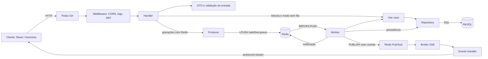
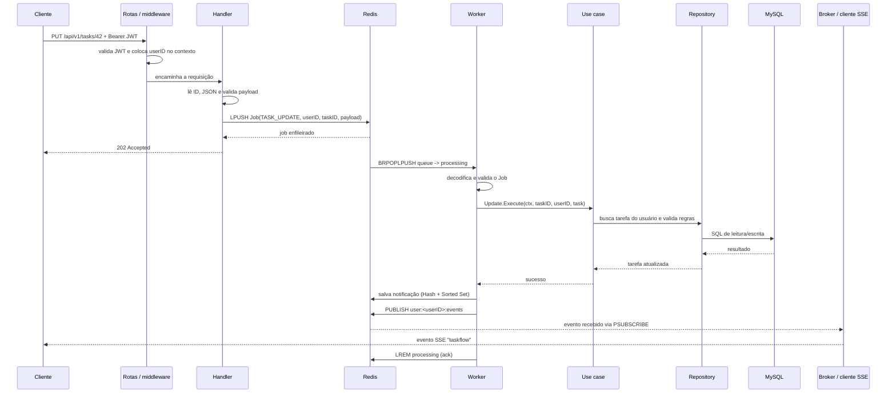

# Como o backend funciona: camadas, Redis e fluxo de dados

Este guia acompanha uma operação concreta do TaskFlow e explica como as partes
do backend colaboram. O foco é a pasta `03-go-redis-architecture`: nela, o
MySQL continua sendo a persistência principal, enquanto o Redis é usado para
enfileirar gravações, publicar eventos e armazenar notificações.

## Visão geral



As responsabilidades são separadas: HTTP trata protocolo e identidade,
use cases aplicam regras da aplicação, repositories falam com o MySQL e Redis
coordena trabalho assíncrono e entrega eventos. Redis não substitui o MySQL
como fonte principal das tarefas, listas e tags.

## O que acontece ao iniciar a API

1. `backend/main.go` carrega configuração do ambiente e conecta ao MySQL.
2. Cria o cliente Redis a partir de `REDIS_URL` e verifica a conexão com `PING`.
   Se MySQL ou Redis não estiver disponível, a inicialização falha explicitamente.
3. `routes.SetupRouterWithContext` compõe módulos e rotas, inicia o worker e o
   broker SSE em goroutines, e configura o servidor Gin.
4. Ao receber `SIGINT` ou `SIGTERM`, o servidor encerra requisições em andamento
   e cancela o contexto usado pelas tarefas de fundo.

O grafo de dependências é montado manualmente em
`internal/module/module.go`: repositories são passados aos use cases, estes
chegam aos handlers, e as dependências de Redis conectam producer, worker,
broadcaster e broker.

## Exemplo: atualizar uma tarefa

Considere uma chamada autenticada `PUT /api/v1/tasks/42` com um JSON de tarefa.



### 1. Entrada HTTP, rota e autenticação

As rotas ficam em `internal/routes`. Middlewares globais aplicam logging,
recovery, CORS e cabeçalho de conteúdo. Nas rotas protegidas,
`internal/middleware/auth_middleware.go` valida o JWT e guarda o identificador
do usuário no contexto Gin. O handler obtém esse `userID`; ele é usado também
para limitar o acesso aos dados do usuário.

O endpoint SSE aceita token pela query string porque o `EventSource` do
navegador não permite definir livremente o cabeçalho `Authorization`. Para
requisições normais, a autenticação usa `Authorization: Bearer <token>`.

### 2. DTO e Handler: fronteira HTTP

O handler converte JSON em DTO (`internal/dto`), verifica parâmetros da rota e
transforma o DTO em tipo de domínio (`internal/types`). Ele traduz resultados
em códigos HTTP e respostas JSON. Não é a camada que executa SQL.

Com Redis configurado, operações de escrita como criar, atualizar ou excluir
tarefa são enfileiradas. O handler responde `202 Accepted` quando Redis aceitou
o job; isso significa **aceito para processamento**, não que a alteração já foi
gravada no MySQL. Falha ao enfileirar resulta em erro HTTP, não em sucesso
falso. Sem producer configurado, o handler segue o caminho síncrono do use case.

### 3. Redis Producer: colocar trabalho na fila

`internal/queue/producer.go` serializa um `Job` em JSON e executa `LPUSH` na
lista `taskflow:queue`. O job contém a ação (por exemplo `TASK_UPDATE`), o
`user_id`, o ID da entidade quando necessário e o payload.

Redis aqui funciona como uma fila de trabalho, não como banco de tarefas.
O identificador do usuário acompanha o job para que o worker aplique as mesmas
regras de autorização/escopo ao executar o caso de uso.

### 4. Worker: consumir, executar e recuperar falhas

`internal/queue/worker.go` bloqueia aguardando jobs com `BRPOPLPUSH`, movendo o
job de `taskflow:queue` para `taskflow:processing`. Isso evita retirar o item
da fila sem deixar um registro em processamento.

O worker decodifica e valida a ação; então o dispatcher encaminha a operação
para o use case correspondente. Erros transitórios são tentados novamente,
até cinco tentativas. Erros considerados permanentes ou jobs que esgotaram as
tentativas vão para `taskflow:dead-letter`. Ao iniciar, o worker tenta devolver
à fila itens que sobraram em `taskflow:processing` após uma interrupção.
Depois do sucesso (ou envio para dead-letter), o item é removido de
`processing` (acknowledgment).

Esse mecanismo melhora a recuperação de interrupções, mas não torna toda a
operação uma transação distribuída: o efeito no MySQL e o acknowledgment no
Redis são operações separadas. Por isso, o processamento pode ser repetido em
certos cenários; operações assíncronas devem considerar idempotência.

### 5. Use case: regras da aplicação

Os use cases em `internal/usecase` recebem tipos de domínio e coordenam a
operação. Por exemplo, o use case de criação de tarefa valida campos, confirma
que a lista pertence ao usuário, define status e timestamps e pede ao
repository para persistir.

Separar essa lógica do Gin permite que o mesmo comportamento seja chamado pelo
handler síncrono ou pelo worker, sem duplicar regras de negócio.

### 6. Repository e MySQL: persistência principal

Os repositories em `internal/repository` encapsulam consultas SQL e convertem
resultados para tipos de domínio. O MySQL guarda tarefas, listas, tags e
usuários. Assim, uma leitura da API percorre normalmente Handler → Use case →
Repository → MySQL e responde na mesma requisição; não passa pela fila Redis.

## Notificação armazenada versus evento em tempo real

Depois que o worker conclui uma escrita com sucesso, ele faz duas coisas
distintas:

1. **Armazena uma notificação no Redis**, usando um Hash
   `taskflow:user:<id>:notifications` e um Sorted Set
   `taskflow:user:<id>:notifications:index`. Os endpoints de notificações
   consultam esses dados e permitem marcar ou excluir notificações.
2. **Publica um evento no Redis Pub/Sub**, no canal
   `user:<id>:events`. `internal/transport/sse/broker.go` mantém uma assinatura
   por padrão (`user:*:events`) e encaminha o payload para clientes conectados
   daquele usuário. `GET /api/v1/events` mantém a conexão HTTP aberta e envia
   os dados como Server-Sent Events.

O armazenamento da notificação permite consultá-la depois; Pub/Sub serve para
entrega ao vivo. Pub/Sub, por si só, não é histórico: clientes desconectados
não recebem eventos publicados enquanto estavam fora. O cliente pode consultar
as notificações armazenadas ao reconectar.

## Leituras e escritas em resumo

```text
Leitura:
Cliente -> Gin/Auth -> Handler -> Use case -> Repository -> MySQL -> resposta

Escrita assíncrona (Redis configurado):
Cliente -> Gin/Auth -> Handler/DTO -> Redis queue -> 202 Accepted
                                           |
                                           v
Worker -> Dispatcher -> Use case -> Repository -> MySQL
   |                                               |
   +-> notificação Redis + evento Pub/Sub <- sucesso
```

## Onde procurar no código

| Responsabilidade                            | Arquivo/pasta                                      |
| ------------------------------------------- | -------------------------------------------------- |
| Inicialização, configuração e shutdown      | `backend/main.go`                                  |
| Composição das dependências e worker        | `backend/internal/module/module.go`                |
| Rotas e middlewares globais                 | `backend/internal/routes/routes.go`                |
| JWT e identidade no contexto                | `backend/internal/middleware/auth_middleware.go`   |
| DTOs HTTP                                   | `backend/internal/dto/`                            |
| Exemplo de handler e enfileiramento         | `backend/internal/handler/task_handler.go`         |
| Producer, Job e validações da fila          | `backend/internal/queue/producer.go`               |
| Worker, retries, dead-letter e ack          | `backend/internal/queue/worker.go`                 |
| Regras de tarefa                            | `backend/internal/usecase/task/usecases.go`        |
| SQL de tarefa                               | `backend/internal/repository/task_repository.go`   |
| Publicação de eventos                       | `backend/internal/pubsub/broadcaster.go`           |
| Assinatura Redis e distribuição por usuário | `backend/internal/transport/sse/broker.go`         |
| Endpoint SSE                                | `backend/internal/handler/events_handler.go`       |
| Rotas de notificações                       | `backend/internal/handler/notification_handler.go` |

## Conceitos para explorar

- **Fila Redis:** listas e operações bloqueantes (`LPUSH`, `BRPOPLPUSH`,
  `LREM`); observe por que o worker mantém uma lista de processamento.
- **Retentativas e dead-letter:** diferencie falhas transitórias de dados
  inválidos e pense em como inspecionar/reprocessar jobs com segurança.
- **Pub/Sub:** compare entrega em tempo real com persistência; uma publicação
  não cria um histórico para consumidores desconectados.
- **SSE:** conexão HTTP unidirecional e persistente do servidor para o cliente;
  compare com WebSocket, que permite comunicação bidirecional.
- **Idempotência e consistência:** examine o que ocorreria se o processo
  terminasse após gravar no MySQL, mas antes de confirmar o job no Redis.
